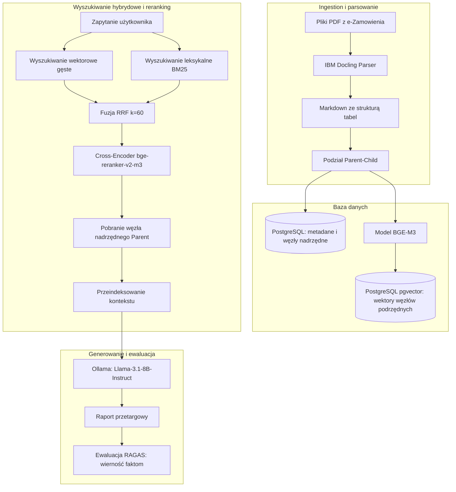

# GisMarketIntelligenceAi

Lokalny system RAG do analizy specyfikacji warunków zamówienia (SWZ), weryfikacji barier rynkowych i analizy konkurencji w polskich przetargach geodezyjnych oraz systemach informacji przestrzennej (SIP).

[](https://www.python.org/)
[](https://www.llamaindex.ai/)
[](https://github.com/DS4SD/docling)
[](https://github.com/pgvector/pgvector)
[-black.svg)](https://ollama.com/)
[](https://github.com/explodinggradients/ragas)
[](LICENSE)

---

## Cel projektu

Dokumentacja przetargowa (SWZ i OPZ) w administracji samorządowej w obszarze geodezji i systemów informacji przestrzennej zawiera:
* Macierze punktacji i kryteria oceny ofert,
* Wymagania techniczne dotyczące baz BDOT500 oraz GESUT,
* Wymogi transformacji danych między układami współrzędnych (np. układ 1965 do PL-2000),
* Zapisy ograniczające konkurencję (vendor lock-in na rzecz dostawców takich jak Geo-System, GIAP, Geobid).

System automatyzuje ekstrakcję danych z wielostronicowych plików PDF, indeksuje treść z zachowaniem kontekstu tabel i generuje raporty techniczno-prawne dla zespołów przetargowych.

---

## Architektura systemu

Potok przetwarzania wykorzystuje dwuetapowe wyszukiwanie oraz hierarchiczny podział tekstu:



---

## Komponenty technologiczne

| Warstwa | Technologia | Zastosowanie |
| :--- | :--- | :--- |
| Orkiestracja | LlamaIndex | Obsługa hierarchii Parent-Child, fuzji RRF i integracji z bazą wektorową. |
| Parsowanie PDF | IBM Docling | Ekstrakcja tabel wielostronicowych do formatu Markdown z wykorzystaniem modeli DocLayNet i TableFormer. |
| Baza danych | PostgreSQL 16 z rozszerzeniem pgvector | Przechowywanie relacyjnych metadanych postępowań oraz indeksów wektorowych HNSW. |
| Model embeddingu | BAAI/BGE-M3 | Generowanie wektorów gęstych (1024 wymiary) i rzadkich (wagi leksykalne). |
| Reranking | bge-reranker-v2-m3 | Cross-encoder filtrujący kandydatów do wąskiego kontekstu dla modelu LLM. |
| Model językowy | Ollama (Llama-3.1-8B-Instruct Q4_K_M) | Generowanie raportu z ograniczeniem do faktów zawartych w dokumentacji. |
| Ewaluacja | RAGAS | Weryfikacja wskaźników wierności faktograficznej (faithfulness) i trafności odpowiedzi. |

---

## Struktura dokumentacji

Specyfikacja techniczna projektu znajduje się w katalogu `docs/`:

### Architektura i koncepcje
* [`docs/architecture/system-overview.md`](docs/architecture/system-overview.md): Ogólna architektura systemu, role komponentów i separacja warstw.
* [`docs/architecture/rag-strategy.md`](docs/architecture/rag-strategy.md): Wyszukiwanie hybrydowe, formuła RRF, reranking, podział Parent-Child, GraphRAG, Pre-Retrieval i redukcja halucynacji.
* [`docs/architecture/tech-stack.md`](docs/architecture/tech-stack.md): Porównanie stosu lokalnego i alternatyw chmurowych.
* [`docs/architecture/data-flow.md`](docs/architecture/data-flow.md): Przepływ danych od pobrania SWZ do wygenerowania raportu.

### Domena GovTech i rynek GIS w Polsce
* [`docs/domain-govtech/market-analysis.md`](docs/domain-govtech/market-analysis.md): Analiza rozwiązań Geo-System (e-mapa), GIAP oraz Geobid (EWMAPA, OŚRODEK).
* [`docs/domain-govtech/kio-vendor-lockin.md`](docs/domain-govtech/kio-vendor-lockin.md): Analiza barier rynkowych, formatu .str oraz wyroków Krajowej Izby Odwoławczej.
* [`docs/domain-govtech/gis-standards.md`](docs/domain-govtech/gis-standards.md): Standardy baz BDOT500, GESUT, Rejestru Urbanistycznego i układów współrzędnych (PL-2000, układ 1965).

### Pipeline danych
* [`docs/data-pipeline/ingestion-ezamowienia.md`](docs/data-pipeline/ingestion-ezamowienia.md): Integracja z API e-Zamówienia, limity zapytań i kody CPV.
* [`docs/data-pipeline/parsing-docling.md`](docs/data-pipeline/parsing-docling.md): Konfiguracja parsera Docling do konwersji tabel SWZ do Markdown.
* [`docs/data-pipeline/metadata-schema.md`](docs/data-pipeline/metadata-schema.md): Schemat tabel relacyjnych, struktura payloadu JSONB i indeksy bazy danych.

### Modele i szablony zapytań
* [`docs/models-and-prompts/embeddings-bge-m3.md`](docs/models-and-prompts/embeddings-bge-m3.md): Konfiguracja modelu BGE-M3 i rerankera.
* [`docs/models-and-prompts/llm-ollama.md`](docs/models-and-prompts/llm-ollama.md): Konfiguracja Ollama, parametry kwantyzacji i prompt systemowy.
* [`docs/models-and-prompts/expert-prompts.md`](docs/models-and-prompts/expert-prompts.md): Zestaw zapytań analitycznych oraz format wyjściowy raportu przetargowego.

### Ewaluacja
* [`docs/evaluation/ragas-metrics.md`](docs/evaluation/ragas-metrics.md): Pomiar wierności i trafności odpowiedzi z użyciem biblioteki RAGAS.

### Wdrożenie i uruchomienie
* [`docs/deployment-and-ops/local-setup.md`](docs/deployment-and-ops/local-setup.md): Instrukcja instalacji środowiska lokalnego.
* [`docs/deployment-and-ops/hardware-16gb-ram.md`](docs/deployment-and-ops/hardware-16gb-ram.md): Zarządzanie alokacją pamięci na konfiguracji z 16 GB RAM.
* [`docs/deployment-and-ops/docker-compose.md`](docs/deployment-and-ops/docker-compose.md): Zarządzanie kontenerem bazy danych.

### Przewodniki
* [`docs/guides/test-cases.md`](docs/guides/test-cases.md): Scenariusze testowe dla trudnych przypadków dokumentacji.
* [`docs/guides/troubleshooting.md`](docs/guides/troubleshooting.md): Rozwiązywanie typowych problemów operacyjnych.

---

## Uruchomienie lokalne

### Wymagania
* System operacyjny: Windows z WSL2 / Linux / macOS,
* Pamięć RAM: minimum 16 GB,
* Zainstalowane środowiska: Python 3.11, Docker, Ollama.

```bash
# 1. Klonowanie repozytorium
git clone https://github.com/twoj-login/GisMarketIntelligenceAi.git
cd GisMarketIntelligenceAi

# 2. Uruchomienie bazy danych
docker compose up -d

# 3. Pobranie modelu językowego
ollama pull llama3.1:8b-instruct-q4_K_M

# 4. Utworzenie środowiska wirtualnego
python -m venv .venv
source .venv/bin/activate  # w systemie Windows: .venv\Scripts\activate

# 5. Instalacja zależności
pip install -r requirements.txt
```

---

## Licencja

Projekt udostępniany na warunkach licencji [MIT](LICENSE).
