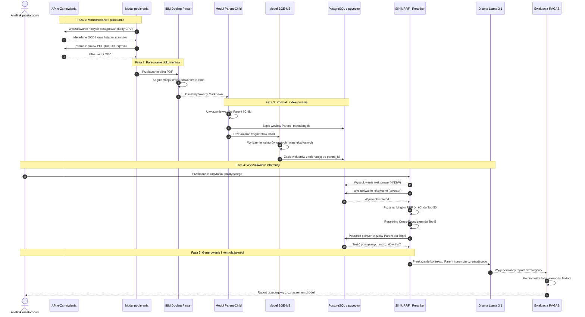

# Przepływ danych w systemie

## 1. Diagram sekwencji przetwarzania

---

## 2. Etapy przetwarzania danych

### Faza 1: Monitorowanie i pobieranie danych
1. Moduł pobierania cyklicznie odpytuje interfejsy BZP oraz OCDS platformy e-Zamówienia.
2. Zastosowany algorytm kolejkowania zapobiega przekroczeniu limitu 30 zapytań na 60 sekund z jednego adresu IP.
3. Pliki załączników (SWZ, OPZ, wzory umów) są pobierane i archiwizowane w lokalnym katalogu roboczym.

### Faza 2: Parsowanie i konwersja do Markdown
1. Plik PDF trafia do silnika IBM Docling.
2. Model TableFormer rekonstruuje układ kolumn i wierszy tabel, w tym struktur scalonych.
3. Moduł OCR odczytuje tekst ze skanów dokumentów z uwzględnieniem polskich znaków diakrytycznych.
4. Wynik jest zapisywany w formacie Markdown z zachowaniem hierarchii nagłówków.

### Faza 3: Hierarchiczny podział i zapis w bazie danych
1. Dokument jest dzielony na węzły nadrzędne (Parent: całe rozdziały) oraz podrzędne (Child: poszczególne wiersze tabel lub akapity).
2. Węzły nadrzędne wraz z metadanymi postępowania trafiają do tabeli relacyjnej.
3. Model BGE-M3 generuje wektory dla węzłów podrzędnych, które są zapisywane w tabeli `chunk_vectors` z indeksem HNSW.

### Faza 4: Wyszukiwanie i reranking
1. Zapytanie użytkownika trafia równolegle do wyszukiwania semantycznego oraz pełnotekstowego.
2. Algorytm Reciprocal Rank Fusion scala listy rankingowe do 50 najlepszych kandydatów.
3. Model Cross-Encoder analizuje pełną relację zapytania do 50 fragmentów i wybiera od 3 do 5 najbardziej trafnych.
4. System pobiera powiązane węzły nadrzędne, dostarczając pełen kontekst otaczający odnalezione komórki tabel.

### Faza 5: Generowanie odpowiedzi i weryfikacja
1. Przygotowany kontekst wraz z promptem uziemiającym trafia do modelu Llama-3.1-8B w środowisku Ollama.
2. Model przygotowuje raport ze wskazaniem numerów stron i załączników.
3. Moduł RAGAS oblicza wskaźnik Faithfulness; raport trafia do analityka po weryfikacji zgodności z dokumentem źródłowym.
