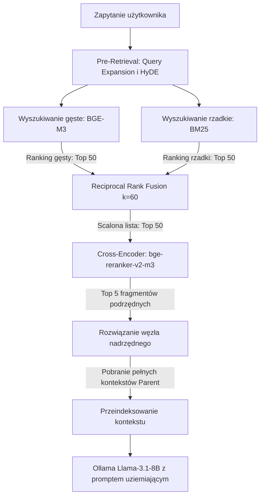

# Strategia przetwarzania RAG

## 1. Ograniczenia standardowego podejścia RAG w dokumentach SWZ

W standardowym podejściu do RAG:
1. Dokument PDF dzielony jest na równe fragmenty (np. 512 tokenów z zakładką 50 tokenów).
2. Każdy fragment jest wektoryzowany za pomocą modelu Bi-Encoder.
3. Zapytanie jest porównywane z bazą wektorów za pomocą miary cosinusowej.
4. Wybrane fragmenty są wklejane do kontekstu modelu językowego.

W dokumentacji przetargowej w branży geodezyjnej i GIS podejście to prowadzi do następujących problemów:
* **Rozrywanie tabel przetargowych**: Podział według liczby znaków oddziela nagłówek kolumny od zawartości komórki wiersza. W efekcie model gubi przyporządkowanie wymogu doświadczenia do konkretnego stanowiska geodety.
* **Gubienie kodów i sygnatur**: Wektory gęste dobrze radzą sobie z pojęciami ogólnymi, lecz słabo rozpoznają dokładne ciągi znaków, takie jak sygnatura wyroku `KIO 1592/24`, kod formatu `ewmapa.str` czy kod CPV `72220000-3`.
* **Zjawisko Lost in the Middle**: Modele językowe wykazują niższą uwagę wobec informacji umieszczonych w środku długiego promptu.
* **Halucynacje w danych liczbowych**: Brak bezpośredniego powiązania komórek tabeli sprzyja błędnemu przypisywaniu stawek, wadiów lub terminów.

---

## 2. Architektura Advanced RAG

W celu zachowania poprawności danych liczbowych i prawnych zastosowano wieloetapowy potok przetwarzania:



---

## 3. Etap Pre-Retrieval: Query Expansion i HyDE

### 3.1. Problem rozbieżności zapytań (Query Mismatch)
Pytania analityków formułowane są zwięzłym językiem branżowym, podczas gdy zapisy SWZ i OPZ posługują się sformalizowanym językiem urzędowym. Wektory krótkiego pytania i wielozdaniowego zapisu prawnego mogą znajdować się w znacznej odległości w przestrzeni kosinusowej.

### 3.2. Rozszerzanie zapytań (Query Expansion / Multi-Query)
Model językowy generuje 3-4 warianty semantyczne pytania oryginalnego, co pozwala przeszukać bazę wektorową w szerszym spektrum fraz:
```python
def expand_query(query: str, llm) -> list[str]:
  prompt = (
      "Wygeneruj 3 alternatywne wersje poniższego zapytania do dokumentacji"
      " przetargowej SWZ, używając terminologii urzędowej. Rozdziel wersje"
      f" nową linią:\nPytanie: {query}"
  )
  response = llm.complete(prompt)
  variants = [
      line.strip() for line in response.text.split("\n") if line.strip()
  ]
  return [query] + variants
```

### 3.3. Hipotetyczne osadzenia dokumentów (HyDE)
W technice Hypothetical Document Embeddings model generuje zwięzłą, roboczą odpowiedź na pytanie w stylu urzędowym. Następnie wektor tej wygenerowanej odpowiedzi służy do wyszukiwania rzeczywistych fragmentów w bazie `pgvector`. Zmniejsza to odległość semantyczną między pytaniem a dokumentem źródłowym.

---

## 4. Wyszukiwanie hybrydowe i algorytm RRF

### 4.1. Zasada działania
Wyszukiwanie hybrydowe łączy dwa podejścia:
1. **Wyszukiwanie gęste (Dense Retrieval)**: Wychwytuje powiązania semantyczne, mapując pojęcia bliskoznaczne (np. geoportal gminny i mapa numeryczna).
2. **Wyszukiwanie rzadkie (Sparse Retrieval / BM25)**: Identyfikuje dokładne wystąpienia ciągów znaków (kody CPV, artykuły ustawy, formaty plików, sygnatury KIO).

### 4.2. Fuzja pozycyjna (Reciprocal Rank Fusion)
Wyszukiwanie gęste operuje na wartościach podobieństwa kosinusowego w przedziale $[-1, 1]$, natomiast BM25 zwraca punkty zależne od częstotliwości słów i długości dokumentu. Bezpośrednie łączenie tych wartości wymagałoby ciągłej kalibracji wag.

Algorytm Reciprocal Rank Fusion (RRF) opiera się na pozycji dokumentu w poszczególnych rankingach:

$$RRF\_Score(d \in D) = \sum_{m \in M} \frac{1}{k + r_m(d)}$$

Gdzie:
* $M$ to zbiór metod wyszukiwania ($M = \{\text{Dense}, \text{Sparse}\}$),
* $r_m(d)$ to pozycja dokumentu $d$ w rankingu metody $m$ (indeksowana od 1),
* $k$ to stała łagodząca wpływ pierwszych pozycji (wartość domyślna: $k = 60$).

```python
from typing import Any, Dict, List


def reciprocal_rank_fusion(
    ranked_lists: List[List[Dict[str, Any]]], k: int = 60
) -> List[Dict[str, Any]]:
  scores: Dict[str, float] = {}
  doc_map: Dict[str, Dict[str, Any]] = {}

  for doc_list in ranked_lists:
    for rank, doc in enumerate(doc_list, start=1):
      doc_id = doc["id"]
      if doc_id not in doc_map:
        doc_map[doc_id] = doc
      scores[doc_id] = scores.get(doc_id, 0.0) + (1.0 / (k + rank))

  sorted_ids = sorted(scores.keys(), key=lambda x: scores[x], reverse=True)

  results = []
  for doc_id in sorted_ids:
    item = doc_map[doc_id].copy()
    item["rrf_score"] = scores[doc_id]
    results.append(item)

  return results
```

---

## 5. Reranking za pomocą modeli Cross-Encoder

Modele Bi-Encoder kodują zapytanie $q$ oraz dokument $d$ w niezależnych przejściach:

$$\vec{v}_q = E(q), \quad \vec{v}_d = E(d), \quad Score = \cos(\vec{v}_q, \vec{v}_d)$$

Wadą tego rozwiązania jest brak interakcji pomiędzy pojedynczymi tokenami zapytania i dokumentu w warstwach atencji.

Model Cross-Encoder (`bge-reranker-v2-m3`) przyjmuje połączony ciąg:

$$\text{Input} = [\text{CLS}] \circ q \circ [\text{SEP}] \circ d \circ [\text{SEP}]$$

Dzięki mechanizmowi pełnej atencji krzyżowej model analizuje wzajemny kontekst wszystkich słów pytania i ocenianego fragmentu. Z uwagi na wyższy koszt obliczeniowy, Cross-Encoder analizuje pulę 50 kandydatów wyłonionych przez RRF i wybiera od 3 do 5 fragmentów o najwyższej trafności.

---

## 6. Analiza GraphRAG dla relacji rynkowo-geoprzestrzennych

W analizie zamówień publicznych część pytań analitycznych dotyczy relacji wieloetapowych (multi-hop reasoning), np.:
* *Które gminy w danym powiecie wprowadziły wymóg formatu .str po wyroku KIO dotyczącym sąsiedniej jednostki?*
* *Jacy wykonawcy wygrywali przetargi z kodem CPV 72220000-3 w gminach korzystających z technologii Geo-System?*

Klasyczny wektorowy RAG przetwarza każdy dokument jako odizolowaną wyspę tekstu. Zastosowanie **GraphRAG** (grafu wiedzy):
1. Ekstrahuje encje: `Gmina`, `Wykonawca`, `FormatPliku`, `WyrokKIO`, `BazaDanych`.
2. Mapuje relacje kierunkowe: `(Gmina)-[:WYMAGA]->(FormatPliku)`, `(Wykonawca)-[:WYGRAL]->(Przetarg)`, `(WyrokKIO)-[:UCHYLIL]->(ZapisSWZ)`.
3. Pozwala na agregację wiedzy rozproszonej w setkach postępowań na przestrzeni wielu lat. W bieżącym stosie technologicznym relacje te są modelowane w tabelach relacyjnych PostgreSQL, z możliwością migracji do Apache AGE lub Neo4j w kolejnych etapach rozwoju.

---

## 7. Hierarchiczny podział tekstu (Parent-Child)

W celu zachowania równowagi między precyzją wyszukiwania a pełnym kontekstem merytorycznym zastosowano podział dwupoziomowy:

1. **Węzeł nadrzędny (Parent Node)**:
   * Reprezentuje spójny rozdział specyfikacji lub całą tabelę załącznika technicznego.
   * Rozmiar: od 1000 do 2500 tokenów.
   * Zapisywany w bazie relacyjnej pod identyfikatorem `parent_id`.

2. **Węzeł podrzędny (Child Node)**:
   * Reprezentuje pojedynczy akapit lub wiersz tabeli sformatowany w składni Markdown.
   * Rozmiar: od 128 do 256 tokenów.
   * Podlega wektoryzacji i indeksowaniu w `pgvector`.
   * Przechowuje powiązanie do swojego `parent_id`.

3. **Pobieranie kontekstu**:
   * Po wyłonieniu fragmentu podrzędnego przez potok RRF i Cross-Encoder, system pobiera z bazy cały węzeł nadrzędny powiązany przez `parent_id`.
   * Model językowy otrzymuje pełny rozdział zawierający odnaleziony wymóg.

---

## 8. Uporządkowanie kontekstu (LongContextReorder)

Aby zminimalizować ryzyko pomijania fragmentów umieszczonych w środku promptu, przed przekazaniem kontekstu do modelu Llama 3.1 stosowane jest przetasowanie:
* Fragment o najwyższej ocenie trafia na początek promptu,
* Drugi pod względem trafności fragment umieszczany jest na końcu promptu,
* Pozostałe fragmenty zajmują pozycje środkowe.

---

## 9. Ograniczanie halucynacji

1. **Uziemienie w prompcie systemowym**:
   Model otrzymuje instrukcję nakazującą udzielanie odpowiedzi wyłącznie na podstawie przekazanych fragmentów. Przy każdym fakcie lub wartości liczbowej wymagane jest wskazanie numeru załącznika, strony i rozdziału. W przypadku braku danych w kontekście model ma obowiązek zwrócić informację o braku podstawy w dokumentacji.
2. **Zachowanie formatu tabel**:
   Ustrukturyzowany format Markdown generowany przez parser Docling zachowuje przypisanie wartości do nagłówków kolumn.
3. **Weryfikacja automatyczna**:
   Odpowiedzi podlegają kontroli metryką Faithfulness w bibliotece RAGAS przed udostępnieniem użytkownikowi.
