# Architektura ogólna systemu

## 1. Wprowadzenie i kontekst biznesowy

System GisMarketIntelligenceAi przetwarza i analizuje dokumentację przetargową w postępowaniach o udzielenie zamówień publicznych w Polsce, prowadzonych zgodnie z ustawą Prawo Zamówień Publicznych (PZP).

Zamówienia w sektorze samorządowym (urzędy gmin, miast, starostwa powiatowe) obejmujące:
* Tworzenie i modernizację systemów informacji przestrzennej (SIP / GIS),
* Prowadzenie i aktualizację baz danych obiektów topograficznych (BDOT500),
* Prowadzenie geodezyjnej ewidencji sieci uzbrojenia terenu (GESUT),
* Dostosowanie dokumentów planistycznych do formatu Rejestru Urbanistycznego,
charakteryzują się wielostronicowymi specyfikacjami (SWZ, OPZ), złożonymi tabelami kryteriów oceny ofert oraz załącznikami technicznymi.

Występujące trudności operacyjne:
1. **Objętość materiału**: Manualna analiza specyfikacji liczącej 100-200 stron wymaga od inżyniera wielu godzin pracy.
2. **Ryzyko prawne**: Zapisy przetargowe bywają konstruowane w sposób faworyzujący dotychczasowych wykonawców (np. wymóg obsługi zamkniętych formatów danych). Czas na zadanie pytań lub wniesienie odwołania do Krajowej Izby Odwoławczej (KIO) wynosi zazwyczaj od 5 do 10 dni.
3. **Błędy interpretacyjne**: Standardowe wyszukiwarki słownikowe oraz proste modele językowe zrywają relacje wiersz-kolumna w tabelach, myląc wagi punktowe z terminami realizacji lub karami umownymi.

---

## 2. Diagram architektury warstwowej

```mermaid
graph TD
    subgraph DataSources [Źródła danych]
        DS1[Platforma e-Zamówienia BZP API]
        DS2[Repozytorium OCDS / CRD]
        DS3[Baza orzecznictwa KIO]
        DS4[Dokumentacja techniczna systemów SIP]
    end

    subgraph IngestionParsing [Ingestion i ekstrakcja]
        IP1[Klient asynchroniczny z rate limiterem]
        IP2[IBM Docling: DocLayNet i TableFormer]
        IP3[Konwerter do ustrukturyzowanego Markdown]
        IP4[Podział węzłów Parent-Child]
    end

    subgraph StorageIndex [Baza danych i indeksowanie]
        SI1[(PostgreSQL 16)]
        SI2[(Rozszerzenie pgvector: indeks HNSW)]
        SI3[BGE-M3: wektory gęste 1024d]
        SI4[BGE-M3: wektory rzadkie / wagi leksykalne]
    end

    subgraph QueryPipeline [Potok wyszukiwania]
        QP1[Dekompozycja i rozszerzanie zapytań]
        QP2[Wyszukiwanie wektorowe gęste]
        QP3[Wyszukiwanie leksykalne BM25]
        QP4[Reciprocal Rank Fusion RRF k=60]
        QP5[Cross-Encoder bge-reranker-v2-m3]
        QP6[Rozwiązanie węzła nadrzędnego Parent]
    end

    subgraph InferenceAndEval [Wnioskowanie i ewaluacja]
        IE1[Ollama: Llama-3.1-8B-Instruct Q4_K_M]
        IE2[Szablon promptu z rygorystycznym uziemieniem]
        IE3[Moduł ewaluacji RAGAS]
        IE4[Interfejs użytkownika]
    end

    DataSources --> IngestionParsing
    IngestionParsing --> StorageIndex
    StorageIndex <--> QueryPipeline
    QueryPipeline --> InferenceAndEval
```

---

## 3. Komponenty systemu

### 3.1. Moduł pobierania danych (Ingestion Engine)
Komunikuje się z Platformą e-Zamówienia poprzez protokoły REST i OCDS:
* Wykorzystuje mechanizm kolejkowania ograniczający częstotliwość wywołań do maksymalnie 30 zapytań na 60 sekund z jednego adresu IP, co zapobiega blokadom HTTP 403 Forbidden.
* Pobiera metadane postępowania (identyfikator OCDS, kody CPV, termin składania ofert, szacunkowy budżet).
* Pobiera pliki załączników (SWZ, OPZ, wzory umów, formularze ofertowe).

### 3.2. Moduł ekstrakcji wizualno-tekstowej (IBM Docling)
Przetwarza pliki PDF na format Markdown:
* **DocLayNet**: Identyfikuje segmenty strony (nagłówki, treść, tabele, stopki).
* **TableFormer**: Odtwarza strukturę tabel, w tym komórki scalone i tabele przechodzące na kolejne strony.
* **Silnik OCR**: Odczytuje tekst ze skanowanych dokumentów za pomocą biblioteki EasyOCR z polskim słownikiem.

### 3.3. Silnik indeksowania hierarchicznego
* Dzieli dokument na węzły nadrzędne (Parent: 1000-2500 tokenów) oraz węzły podrzędne (Child: 128-256 tokenów).
* Generuje wektory gęste i rzadkie za pomocą modelu BGE-M3.
* Zapisuje węzły nadrzędne w tabeli relacyjnej, a węzły podrzędne w tabeli z indeksem wektorowym pgvector HNSW.

### 3.4. Potok wyszukiwania dwuetapowego
* **Etap pierwszy (wyszukiwanie szerokie)**: Wykonuje równolegle wyszukiwanie semantyczne (podobieństwo kosinusowe) oraz leksykalne (BM25), a następnie łączy wyniki algorytmem Reciprocal Rank Fusion (RRF, $k=60$) do puli 50 kandydatów.
* **Etap drugi (reranking)**: Model bge-reranker-v2-m3 ocenia relację zapytania do każdego z 50 fragmentów, wybierając od 3 do 5 najbardziej relewantnych.
* **Pobranie kontekstu nadrzędnego**: Dla wyselekcjonowanych węzłów podrzędnych system pobiera powiązane węzły nadrzędne (Parent Context).

### 3.5. Moduł wnioskowania (Local LLM)
* Uruchamiany w środowisku Ollama model Llama-3.1-8B-Instruct (kwantyzacja Q4_K_M).
* Generuje raport w oparciu o prompt nakazujący podawanie numeru strony i załącznika dla każdego przywołanego faktu.

### 3.6. Moduł ewaluacji (RAGAS)
* Weryfikuje każdą wygenerowaną odpowiedź pod kątem wierności faktom (faithfulness) oraz trafności odpowiedzi (answer relevancy).
* Odrzuca odpowiedzi niespełniające założonego progu wiarygodności.

---

## 4. Zasady bezpieczeństwa i architektury środowiska

1. **Przetwarzanie lokalne**: Dokumentacja przetargowa, treść zapytań i wygenerowane analizy pozostają w lokalnej sieci i nie są przekazywane do zewnętrznych interfejsów API.
2. **Przewidywalność kosztowa**: Zastosowanie modeli open-source eliminuje zmienne koszty rozliczeń za tokeny.
3. **Izolacja danych**: PostgreSQL działa w kontenerze Docker z dedykowanym wolumenem na dysku lokalnym.
