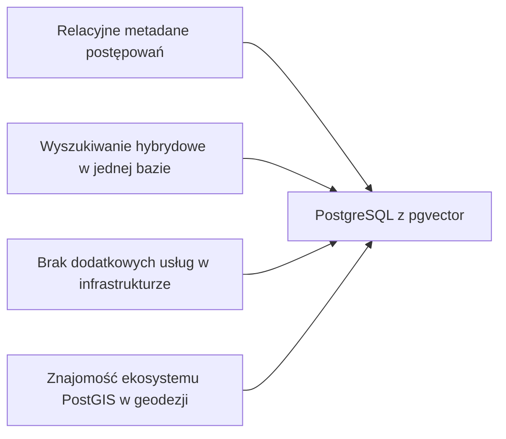

# Stos technologiczny i decyzje inżynierskie

## 1. Porównanie stosu lokalnego i rozwiązań chmurowych

Architektura opiera się na otwartych komponentach uruchamianych lokalnie na stacji roboczej z 16 GB pamięci RAM, z opcją przełączenia na usługi chmurowe.

| Warstwa | Stos lokalny | Alternatywa chmurowa | Uzasadnienie wyboru stosu lokalnego |
| :--- | :--- | :--- | :--- |
| Baza danych i wektorów | PostgreSQL 16 z pgvector (Docker) | Qdrant Cloud / Pinecone | Łączenie relacyjnych metadanych przetargów i indeksów wektorowych w jednym silniku bazodanowym bez opłat licencyjnych. |
| Parsowanie dokumentów | IBM Docling (DocLayNet, TableFormer) | LlamaParse API | Brak opłat za przetwarzane strony; lokalne rozpoznawanie tabel ze skanów i plików PDF. |
| Orkiestracja | LlamaIndex Python | LangChain / LangGraph | Zoptymalizowane moduły do podziału Parent-Child, fuzji RRF i integracji z bazą pgvector. |
| Model embeddingu | BAAI/BGE-M3 (lokalnie przez HuggingFace) | OpenAI text-embedding-3-large | Generowanie wektorów gęstych i wag leksykalnych w jednym modelu; okno kontekstowe do 8192 tokenów. |
| Reranking | bge-reranker-v2-m3 (Cross-Encoder) | Cohere Rerank API | Weryfikacja trafności kandydatów na lokalnym procesorze bez wysyłania danych do podmiotów trzecich. |
| Model językowy | Ollama: Llama-3.1-8B-Instruct (Q4_K_M) | GPT-4o / Claude 3.5 Sonnet | Przetwarzanie dokumentacji w sieci lokalnej; zużycie pamięci rzędu 4.7 GB RAM. |
| Ewaluacja | Biblioteka RAGAS | Platformy ewaluacyjne SaaS | Weryfikacja wskaźnika wierności faktom bezpośrednio w skryptach testowych. |

---

## 2. Baza danych: PostgreSQL z rozszerzeniem pgvector

Przy wyborze bazy danych uwzględniono PostgreSQL z pgvector, Qdrant, Milvus oraz Chroma.

### Kryteria wyboru:

1. **PostgreSQL z pgvector**:
   * Dokumentacja przetargowa wymaga przechowywania relacyjnych struktur danych: identyfikatorów jednostek, terminów, kwot budżetów, kodów CPV oraz historii odpytań. PostgreSQL pozwala trzymać dane tabelaryczne i wektory w ramach jednej transakcji.
   * Branża GIS powszechnie stosuje PostgreSQL w połączeniu z rozszerzeniem PostGIS, co ułatwia zarządzanie środowiskiem.
   * Do indeksowania wektorów wykorzystywany jest indeks HNSW (`hnsw (vector_cosine_ops)`) z parametrami `m = 16` i `ef_construction = 64`.

2. **Qdrant i Milvus**:
   * Dedykowane bazy wektorowe sprawdzają się przy bardzo dużych zbiorach danych, lecz wymagałyby uruchamiania oddzielnego klastra obok bazy relacyjnej.

3. **Chroma**:
   * Proste rozwiązanie do prototypów, o mniejszych możliwościach w zakresie złożonych filtrów relacyjnych.

---

## 3. Ekstrakcja danych z plików PDF: IBM Docling

Pliki SWZ i OPZ publikowane przez urzędy zawierają tabele kryteriów, wielopoziomowe nagłówki oraz skany operatów. Tradycyjne narzędzia oparte wyłącznie na ekstrakcji tekstu gubią strukturę kolumn.

| Narzędzie | Metoda ekstrakcji | Odwzorowanie tabel | Koszt |
| :--- | :--- | :--- | :--- |
| PyMuPDF / pdfminer | Analiza pozycji tekstu | Niskie (częste łączenie kolumn) | 0 zł |
| IBM Docling | Modele wizyjne DocLayNet i TableFormer | Wysokie (rekonstrukcja wierszy) | 0 zł (kod otwarty) |
| Unstructured | Heurystyki i klasyfikacja bloków | Średnie | Wersja otwarta / płatna chmura |
| LlamaParse | Analiza z użyciem modeli LLM | Bardzo wysokie | Płatne API |

Docling wybrano ze względu na możliwość lokalnego uruchomienia bez kosztów API oraz skuteczną konwersję złożonych tabel do składni Markdown.

---

## 4. Wybór modelu embeddingu: BAAI/BGE-M3

Analiza modeli do zadań odzyskiwania informacji w języku polskim:

1. **PolDense (OPI)**:
   * Bardzo dobre wyniki w rankingu PIRB dla języka polskiego, jednak model generuje wyłącznie wektory gęste i w wersji 1B wymaga znacznych zasobów RAM.
2. **OpenAI text-embedding-3-large**:
   * Wysoka jakość reprezentacji, lecz wiąże się z opłatami za tokeny i przesyłaniem danych do chmury.
3. **BAAI/BGE-M3**:
   * Obsługuje język polski w tym terminologię administracyjną.
   * Generuje w jednym przejściu wektory gęste (1024 wymiary) oraz wagi leksykalne dla wyszukiwania rzadkiego.
   * Obsługuje okno kontekstowe do 8192 tokenów.
   * Wykazuje odporność na literówki i błędy rozpoznawania znaków diakrytycznych w skanach.

---

## 5. Model językowy: Ollama z modelem Llama-3.1-8B-Instruct

* Format: GGUF w kwantyzacji Q4_K_M.
* Zapotrzebowanie pamięciowe: około 4.7 GB RAM.
* Środowisko uruchomieniowe: Ollama z wykorzystaniem instrukcji AVX2 procesora lub akceleracji karty graficznej.
* Umożliwia stabilną pracę całego stosu na komputerze z 16 GB RAM.
