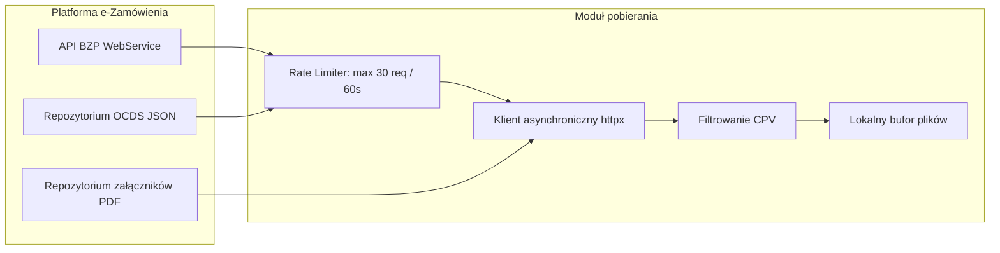

# Integracja z Platformą e-Zamówienia i pobieranie danych

## 1. Interfejsy sieciowe e-Zamówienia

Źródłem danych o zamówieniach publicznych w Polsce jest Platforma e-Zamówienia prowadzona przez Urząd Zamówień Publicznych (UZP).

Dostęp do danych realizowany jest przez dwa kanały:
1. **API BZP (Biuletyn Zamówień Publicznych)**: WebService udostępniający ogłoszenia o postępowaniach, ich zmianach oraz wynikach.
2. **Repozytorium OCDS (Open Contracting Data Standard)**: REST API udostępniające dane w formacie JSON zgodnym ze standardem OCDS.



---

## 2. Ograniczenia przepustowości (Rate Limiting)

Platforma e-Zamówienia nakłada ograniczenia na liczbę wywołań:
* **Maksymalny limit**: 30 zapytań z jednego adresu IP w oknie 60 sekund.
* **Skutek przekroczenia**: Blokada adresu IP i kod odpowiedzi HTTP 403 Forbidden.
* **Wymagania sieciowe**: Obsługa protokołu TLS w wersji 1.3.

```python
import asyncio
import time
import httpx


class EZamowieniaRateLimiter:
  """Ogranicza liczbę wywołań API do maksymalnie 28 na 60 sekund."""

  def __init__(self, max_requests: int = 28, period_seconds: float = 60.0):
    self.max_requests = max_requests
    self.period = period_seconds
    self.timestamps = []
    self._lock = asyncio.Lock()

  async def acquire(self):
    async with self._lock:
      now = time.monotonic()
      self.timestamps = [t for t in self.timestamps if now - t < self.period]

      if len(self.timestamps) >= self.max_requests:
        sleep_time = self.period - (now - self.timestamps[0]) + 0.5
        if sleep_time > 0:
          await asyncio.sleep(sleep_time)
          now = time.monotonic()
          self.timestamps = [
              t for t in self.timestamps if now - t < self.period
          ]

      self.timestamps.append(now)


async def fetch_procurement_notices(
    client: httpx.AsyncClient, limiter: EZamowieniaRateLimiter, url: str
):
  await limiter.acquire()
  headers = {
      "User-Agent": "GisMarketIntelligence/1.0",
      "Accept": "application/json",
  }
  response = await client.get(url, headers=headers, timeout=30.0)
  response.raise_for_status()
  return response.json()
```

---

## 3. Filtrowanie po kodach CPV

Pipeline pobiera wyłącznie postępowania powiązane ze słownikiem CPV (Common Procurement Vocabulary) dla usług geodezyjnych i informatycznych:

| Kod CPV | Nazwa słownikowa | Zastosowanie |
| :--- | :--- | :--- |
| **72220000-3** | Usługi doradcze w zakresie systemów i doradztwo techniczne | Wdrożenia i modernizacje systemów SIP. |
| **48321000-4** | Pakiety oprogramowania do projektowania wspomaganego komputerowo (CAD) | Zakupy oprogramowania geodezyjnego i licencji GIS. |
| **71354000-4** | Usługi sporządzania map | Prace kartograficzne, wektoryzacja map zasadniczych. |
| **71355000-1** | Usługi pomiarowe | Pomiary sytuacyjno-wysokościowe, inwentaryzacje powykonawcze. |
| **71354100-5** | Usługi digitalizacji map | Konwersja analogowych map ewidencyjnych. |
| **71354300-7** | Usługi badań katastralnych | Modernizacja EGiB, zakładanie baz BDOT500 i GESUT. |

---

## 4. Pobieranie załączników

1. Po wyfiltrowaniu ogłoszenia system pobiera listę dokumentów powiązanych z postępowaniem.
2. Obsługiwane rozszerzenia: PDF, ZIP, 7Z.
3. Archiwa są rozpakowywane w katalogu tymczasowym.
4. Każdy plik jest oznaczany skrótem SHA-256 w celu uniknięcia ponownego przetwarzania identycznych załączników.
