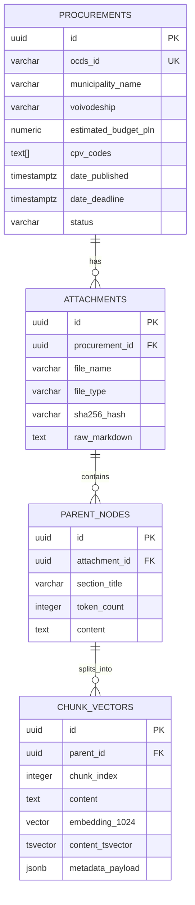

# Schemat bazy danych i metadanych

## 1. Relacyjny model danych

System przechowuje dane w bazie PostgreSQL 16 z rozszerzeniem `pgvector`. Model łączy dane relacyjne o postępowaniach i załącznikach z indeksami wektorowymi HNSW dla węzłów podrzędnych.



---

## 2. Definicja schematu w SQL (PostgreSQL 16)

```sql
CREATE EXTENSION IF NOT EXISTS vector;
CREATE EXTENSION IF NOT EXISTS "uuid-ossp";

-- Tabela postępowań przetargowych
CREATE TABLE procurements (
    id UUID PRIMARY KEY DEFAULT uuid_generate_v4(),
    ocds_id VARCHAR(100) UNIQUE NOT NULL,
    title TEXT NOT NULL,
    municipality_name VARCHAR(255) NOT NULL,
    voivodeship VARCHAR(100) NOT NULL,
    estimated_budget_pln NUMERIC(12, 2),
    cpv_codes TEXT[] NOT NULL DEFAULT '{}',
    date_published TIMESTAMPTZ NOT NULL,
    date_deadline TIMESTAMPTZ NOT NULL,
    status VARCHAR(50) DEFAULT 'ACTIVE',
    created_at TIMESTAMPTZ DEFAULT CURRENT_TIMESTAMP
);

CREATE INDEX idx_procurements_ocds ON procurements(ocds_id);
CREATE INDEX idx_procurements_voivodeship ON procurements(voivodeship);
CREATE INDEX idx_procurements_date_deadline ON procurements(date_deadline);
CREATE INDEX idx_procurements_cpv ON procurements USING GIN(cpv_codes);

-- Tabela załączników
CREATE TABLE attachments (
    id UUID PRIMARY KEY DEFAULT uuid_generate_v4(),
    procurement_id UUID NOT NULL REFERENCES procurements(id) ON DELETE CASCADE,
    file_name VARCHAR(255) NOT NULL,
    file_type VARCHAR(50) NOT NULL, -- SWZ, OPZ, CONTRACT, KIO
    sha256_hash CHAR(64) NOT NULL,
    raw_markdown TEXT NOT NULL,
    created_at TIMESTAMPTZ DEFAULT CURRENT_TIMESTAMP
);

-- Tabela węzłów nadrzędnych (Parent Nodes)
CREATE TABLE parent_nodes (
    id UUID PRIMARY KEY DEFAULT uuid_generate_v4(),
    attachment_id UUID NOT NULL REFERENCES attachments(id) ON DELETE CASCADE,
    section_title TEXT,
    token_count INT NOT NULL,
    content TEXT NOT NULL,
    created_at TIMESTAMPTZ DEFAULT CURRENT_TIMESTAMP
);

-- Tabela węzłów podrzędnych i wektorów (Child Nodes)
CREATE TABLE chunk_vectors (
    id UUID PRIMARY KEY DEFAULT uuid_generate_v4(),
    parent_id UUID NOT NULL REFERENCES parent_nodes(id) ON DELETE CASCADE,
    chunk_index INT NOT NULL,
    content TEXT NOT NULL,
    embedding VECTOR(1024) NOT NULL,
    content_tsvector TSVECTOR GENERATED ALWAYS AS (to_tsvector('simple', content)) STORED,
    metadata_payload JSONB NOT NULL DEFAULT '{}',
    created_at TIMESTAMPTZ DEFAULT CURRENT_TIMESTAMP
);

-- Indeks wektorowy HNSW
CREATE INDEX idx_chunks_embedding_hnsw ON chunk_vectors 
USING hnsw (embedding vector_cosine_ops)
WITH (m = 16, ef_construction = 64);

-- Indeks pełnotekstowy GIN
CREATE INDEX idx_chunks_tsvector ON chunk_vectors USING GIN(content_tsvector);

-- Indeks metadanych JSONB
CREATE INDEX idx_chunks_payload ON chunk_vectors USING GIN(metadata_payload);
```

---

## 3. Struktura obiektu payload (JSONB)

Kolumna `metadata_payload` w tabeli `chunk_vectors` przechowuje dane do wstępnego filtrowania:

```json
{
  "procurement_id": "OCDS-143982-2026",
  "document_type": "SWZ",
  "source_municipality": "Urząd Miasta i Gminy Niepołomice",
  "voivodeship": "Małopolskie",
  "cpv_codes": ["72220000-3", "71354000-4"],
  "estimated_budget_pln": 520000.00,
  "detected_technologies": ["BDOT500", "GESUT", "EWMAPA", "Firebird"],
  "detected_red_flags": ["VENDOR_LOCKIN_STR", "ASYMMETRIC_PENALTIES"],
  "page_numbers": [12, 13],
  "is_table_row": true
}
```

---

## 4. Zapytanie hybrydowe w SQL

Łączenie wyszukiwania wektorowego i pełnotekstowego za pomocą formuły RRF z parametrem $k=60$:

```sql
WITH vector_search AS (
    SELECT id, parent_id, content,
           ROW_NUMBER() OVER (ORDER BY embedding <=> '[0.012, -0.045, ...]'::vector) as dense_rank
    FROM chunk_vectors
    WHERE metadata_payload->>'voivodeship' = 'Małopolskie'
    LIMIT 50
),
text_search AS (
    SELECT id, parent_id, content,
           ROW_NUMBER() OVER (ORDER BY ts_rank_cd(content_tsvector, to_tsquery('simple', 'EWMAPA | str | OŚRODEK')) DESC) as sparse_rank
    FROM chunk_vectors
    WHERE content_tsvector @@ to_tsquery('simple', 'EWMAPA | str | OŚRODEK')
    LIMIT 50
)
SELECT 
    COALESCE(v.id, t.id) as chunk_id,
    COALESCE(v.parent_id, t.parent_id) as parent_id,
    COALESCE(v.content, t.content) as content,
    (COALESCE(1.0 / (60 + v.dense_rank), 0.0) + 
     COALESCE(1.0 / (60 + t.sparse_rank), 0.0)) AS rrf_score
FROM vector_search v
FULL OUTER JOIN text_search t ON v.id = t.id
ORDER BY rrf_score DESC
LIMIT 10;
```
