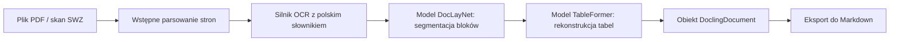

# Parsowanie dokumentów PDF z wykorzystaniem IBM Docling

## 1. Wyzwania ekstrakcji danych z tabel przetargowych

W dokumentach SWZ tabele zawierające kryteria oceny ofert i wymagania techniczne rozciągają się często na kilka stron i zawierają scalone komórki. Standardowe biblioteki do ekstrakcji tekstu z plików PDF (np. `pdfminer`) odczytują znaki w kolejności współrzędnych pionowych, co w przypadku wielokolumnowych tabel powoduje mieszanie treści sąsiadujących kolumn.

---

## 2. Architektura potoku Docling

Narzędzie IBM Docling wykorzystuje modele wizyjne do segmentacji dokumentu i analizy układu tabel:



### Elementy składowe:
1. **DocLayNet**: Klasyfikuje obszary strony na nagłówki, treść główną, tabele i ryciny.
2. **TableFormer**: Odtwarza logiczny układ kolumn i wierszy, łącząc komórki scalone oraz fragmenty tabel przechodzące na kolejną stronę.
3. **EasyOCR**: Silnik OCR ze słownikiem języka polskiego odczytujący znaki diakrytyczne ze skanów.

---

## 3. Implementacja w Pythonie

```python
from pathlib import Path
from docling.datamodel.base_models import InputFormat
from docling.datamodel.pipeline_options import (
    EasyOcrOptions,
    PdfPipelineOptions,
    TableFormerMode,
)
from docling.document_converter import DocumentConverter, PdfFormatOption


def configure_docling_converter() -> DocumentConverter:
  pipeline_options = PdfPipelineOptions()

  # Włączenie dokładnego trybu analizy tabel
  pipeline_options.do_table_structure = True
  pipeline_options.table_structure_options.mode = TableFormerMode.ACCURATE

  # Konfiguracja OCR z obsługą języka polskiego
  pipeline_options.do_ocr = True
  pipeline_options.ocr_options = EasyOcrOptions(lang=["pl", "en"])

  return DocumentConverter(
      format_options={
          InputFormat.PDF: PdfFormatOption(pipeline_options=pipeline_options)
      }
  )


converter = configure_docling_converter()
result = converter.convert("data_raw/SWZ_Gmina_Przyklad.pdf")

# Zapis do pliku Markdown
markdown_text = result.document.export_to_markdown()
Path("data_processed/SWZ_Gmina_Przyklad.md").write_text(
    markdown_text, encoding="utf-8"
)
```

---

## 4. Integracja z LlamaIndex

Wygenerowany Markdown jest przekazywany do parsera węzłów w LlamaIndex:

```python
from llama_index.core.node_parser import MarkdownNodeParser
from llama_index.readers.docling import DoclingReader

reader = DoclingReader()
documents = reader.load_data("data_raw/SWZ_Gmina_Przyklad.pdf")

node_parser = MarkdownNodeParser()
nodes = node_parser.get_nodes_from_documents(documents)
print(f"Utworzono węzłów: {len(nodes)}")
```

---

## 5. Przykładowa struktura tabeli w formacie Markdown

Model TableFormer konwertuje tabelę z pliku PDF do następującej postaci:

```markdown
| Lp. | Kryterium oceny | Waga | Sposób oceny |
| :--- | :--- | :--- | :--- |
| 1 | Cena oferty brutto | 60% | Wzór: (Cena minimalna / Cena badana) * 60 pkt |
| 2 | Doświadczenie kierownika projektu | 40% | Za każdy udokumentowany projekt modernizacji BDOT500: 10 pkt, maks. 40 pkt |
```

Zachowanie nagłówków pozwala modelowi językowemu na jednoznaczne powiązanie wagi 40% z doświadczeniem kierownika, bez pomyłek z kryterium ceny.
