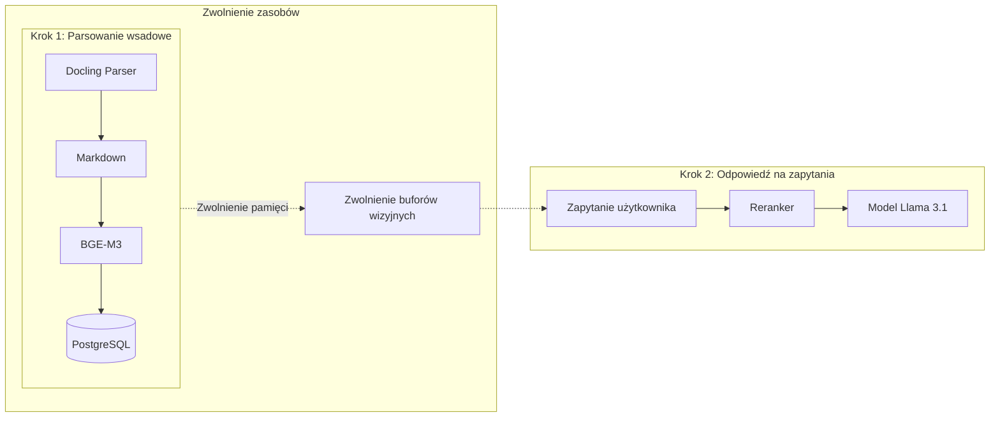

# Zarządzanie pamięcią operacyjną dla konfiguracji 16 GB RAM

## 1. Szacunkowy bilans pamięci RAM

Uruchomienie bazy danych, parsera wizyjnego, modelu embeddingu, rerankera oraz lokalnego modelu językowego wymaga kontroli wykorzystania zasobów.

| Proces | Szacowane zużycie RAM | Funkcja |
| :--- | :--- | :--- |
| System operacyjny i silnik Docker | ~3.2 GB | Obsługa procesów systemowych i kontenerów. |
| PostgreSQL 16 z pgvector (kontener) | ~1.0 GB | Bufor pamięci roboczej bazy danych i indeksów HNSW. |
| Model embeddingu: BGE-M3 | ~2.2 GB | Wektoryzacja tekstu (biblioteka sentence-transformers). |
| Cross-Encoder: bge-reranker-v2-m3 | ~1.5 GB | Reranking puli 50 kandydatów. |
| Model językowy: Ollama Llama-3.1-8B (Q4_K_M) | ~4.7 GB | Generowanie raportu. |
| Rezerwa buforowa | ~3.4 GB | Bufor na operacje OCR i parsowania dokumentów. |
| **Suma** | **~12.6 GB / 16.0 GB** | **Zachowany margines bezpieczeństwa** |

---

## 2. Rozdzielenie etapów przetwarzania

Podczas parsowania wielostronicowych dokumentów PDF model wizyjny TableFormer generuje chwilowe obciążenie pamięci sięgające 2 GB.

Aby uniknąć błędu braku pamięci (Out of Memory):
1. **Separacja czasowa**: Ekstrakcja dokumentów za pomocą Docling odbywa się w osobnym procesie wsadowym przed uruchomieniem zapytań użytkownika.
2. **Czyszczenie pamięci podręcznej**: Po przetworzeniu dokumentów proces zwalnia pamięć przed przekazaniem kontekstu do modelu Llama 3.1.



---

## 3. Zalecenia konfiguracyjne

### 3.1. Czyszczenie pamięci podręcznej PyTorch
```python
import gc
import torch


def free_cache():
  gc.collect()
  if torch.cuda.is_available():
    torch.cuda.empty_cache()
```

### 3.2. Parametry PostgreSQL
W pliku konfiguracyjnym PostgreSQL zaleca się ograniczenie buforów:
```ini
shared_buffers = 512MB
work_mem = 64MB
maintenance_work_mem = 256MB
effective_cache_size = 2GB
```

### 3.3. Plik wymiany
W systemie Windows zaleca się włączenie automatycznego zarządzania rozmiarem pliku stronicowania (`pagefile.sys`) na dysku SSD, z buforem minimum 8 GB.
