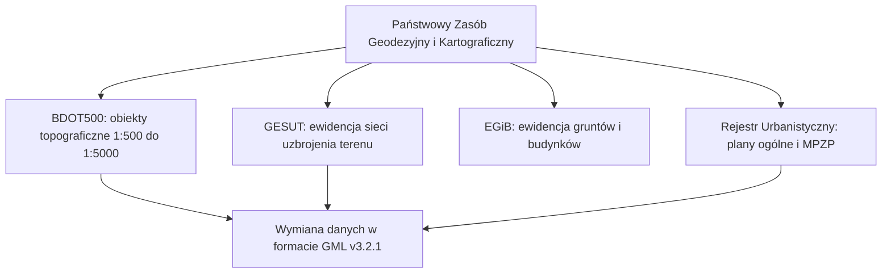

# Standardy geodezyjne i układy współrzędnych w Polsce

## 1. Ramy prawne i bazy państwowego zasobu geodezyjnego

Przetargi w obszarze GovTech/GIS podlegają ustawie z dnia 17 maja 1989 r. Prawo geodezyjne i kartograficzne oraz właściwym rozporządzeniom wykonawczym.

---

## 2. Rejestry przestrzenne w dokumentacji przetargowej

### 2.1. BDOT500 (Baza Danych Obiektów Topograficznych)
* **Zakres**: Obiekty topograficzne o szczegółowości odpowiadającej skalom 1:500 - 1:5000 (jezdnie, chodniki, ogrodzenia, budowle, skarpy).
* **Format wymiany**: Pliki GML zgodne ze schematami aplikacyjnymi GUGiK.
* **Typowe zadania**: Digitalizacja map analogowych, harmonizacja obiektów z pomiarów bezpośrednich oraz kontrola topologii wielokątów.

### 2.2. GESUT (Geodezyjna Ewidencja Sieci Uzbrojenia Terenu)
* **Zakres**: Dane o przewodach podziemnych i napowietrznych (woda, kanalizacja, gaz, prąd, telekomunikacja, ciepło) wraz z armaturą towarzyszącą.
* **Wymagania techniczne**: Przypisanie rzędnych wysokościowych (góra przewodu, dno wykopu, poziom włazu) oraz identyfikacja podmiotów władających siecią.

### 2.3. Rejestr Urbanistyczny i Akty Planowania Przestrzennego (APP)
* **Kontekst formalny**: Ustawa o planowaniu i zagospodarowaniu przestrzennym nakłada na gminy obowiązek uchwalenia Planów Ogólnych Gminy oraz cyfryzacji Miejscowych Planów Zagospodarowania Przestrzennego (MPZP) do ustrukturyzowanych danych wektorowych GML.
* **Przetargi**: Konwersja archiwalnych uchwał planistycznych do formatu wektorowego zgodnego ze specyfikacją APP.

---

## 3. Układy odniesień przestrzennych

Niewłaściwa interpretacja układu współrzędnych prowadzi do niezgodności geometrycznych i problemów na etapie odbioru prac.

### 3.1. Układy współrzędnych płaskich prostokątnych

| Układ współrzędnych | Kod EPSG | Obszar stosowania | Uwagi techniczne |
| :--- | :--- | :--- | :--- |
| **PL-2000 (strefa 5)** | EPSG:2176 | Południk $15^\circ$ E (Polska zachodnia) | Obowiązujący standard dla mapy zasadniczej i baz BDOT/GESUT. |
| **PL-2000 (strefa 6)** | EPSG:2177 | Południk $18^\circ$ E (Polska centralno-zachodnia) | j.w. |
| **PL-2000 (strefa 7)** | EPSG:2178 | Południk $21^\circ$ E (Polska centralno-wschodnia) | j.w. |
| **PL-2000 (strefa 8)** | EPSG:2179 | Południk $24^\circ$ E (Polska wschodnia) | j.w. |
| **Układ 1965** | EPSG:3120 (strefy I-V) | Układ historyczny (materiały archiwalne) | Występuje w starych operatach. Wymaga transformacji empirycznej z użyciem lokalnych poprawek. |
| **PL-1992** | EPSG:2180 | Opracowania ogólne w małych skalach | Nie może być stosowany do opracowań w skali 1:500. |

### 3.2. Układy wysokościowe
* **PL-EVRF2007-NH**: Aktualnie obowiązujący europejski układ odniesienia wysokościowego o punkcie zerowym w Amsterdamie.
* **Kronsztadt 60 / Kronsztadt 86**: Układy historyczne. Różnice wysokościowe w stosunku do PL-EVRF2007-NH wynoszą od kilkunastu do ponad dwudziestu centymetrów w zależności od rejonu Polski.
* **Wymogi SWZ**: W przypadku nałożenia obowiązku transformacji wysokości ze starych układów, zamawiający powinien udostępnić parametry transformacji lub model geoidy.

---

## 4. Analiza techniczna warunków OPZ

System weryfikuje specyfikacje techniczne pod kątem następujących parametrów:
1. Wymóg kalibracji rastrów bez podania siatki współrzędnych.
2. Zawyżone wymogi dokładnościowe dla obiektów podziemnych bez przewidzenia odkrywek terenowych.
3. Niejednoznaczne granice obszaru opracowania (granice administracyjne gminy a obszary zwartej zabudowy).
