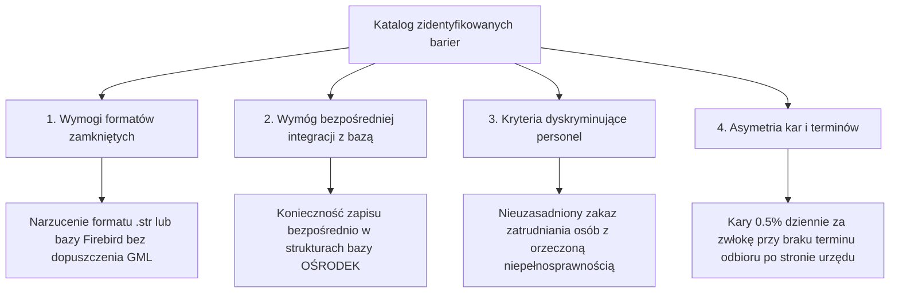

# Identyfikacja barier rynkowych i orzecznictwo KIO

## 1. Naruszenia zasad konkurencji w przetargach geodezyjnych

Zgodnie z ustawą z dnia 11 września 2019 r. Prawo Zamówień Publicznych:
* **Art. 16 pkt 1**: Zamawiający przygotowuje i przeprowadza postępowanie w sposób zapewniający zachowanie uczciwej konkurencji oraz równe traktowanie wykonawców.
* **Art. 99 ust. 4**: Przedmiotu zamówienia nie można opisywać w sposób, który mógłby utrudniać uczciwą konkurencję, w szczególności przez wskazanie znaków towarowych, patentów lub pochodzenia, źródła lub szczególnego procesu, chyba że jest to uzasadnione specyfiką zamówienia i towarzyszą temu wyrazy "lub równoważny".

W postępowaniach na usługi geodezyjne i systemy SIP zamawiający wprowadzają wymagania, które faworyzują określone rozwiązania. System GisMarketIntelligenceAi oznacza takie zapisy flagą ostrzegawczą.

---

## 2. Typowe bariery konkurencyjne

---

### Bariera 1: Wymóg zamkniętych formatów wymiany danych (pliki `.str`)
* **Zapis w SWZ**: *Wykonawca przekaże zaktualizowaną bazę BDOT500 w plikach o strukturze wsadowej .str programu EWMAPA, gwarantujących bezbłędny import do bazy powiatowej.*
* **Kwalifikacja**: Format `.str` jest autorskim formatem firmy Geobid. Wykonawcy pracujący na innych platformach GIS nie mają możliwości generowania tego formatu bez zakupu dodatkowych licencji.
* **Podstawa zarzutu**: Wymóg narusza art. 16 i art. 99 ust. 4 PZP. Powszechnie obowiązującym standardem wymiany danych geodezyjnych w Polsce jest format GML zgodny ze schematami aplikacyjnymi GUGiK.

### Bariera 2: Ograniczenia personelu w warunkach udziału
* **Zapis w SWZ**: *Kierownik zespołu musi posiadać pełną zdolność psychofizyczną do pracy w terenie, bez orzeczonych ograniczeń zdrowotnych lub stopni niepełnosprawności.*
* **Kwalifikacja**: Zgodnie z orzecznictwem KIO wprowadzanie wymogów wykraczających poza orzeczenie lekarza medycyny pracy narusza zasady równego traktowania. Stopień niepełnosprawności narządu ruchu nie wyklucza pełnienia funkcji kierownika bazy danych pracującego stacjonarnie.

### Bariera 3: Wymóg kompatybilności z konkretną wersją oprogramowania
* **Zapis w SWZ**: *Dostarczone oprogramowanie SIP musi być w pełni kompatybilne z portalem e-mapa w wersji 3.14 działającym w urzędzie.*
* **Kwalifikacja**: Zapis wskazuje konkretny produkt rynkowy bez określenia parametrów równoważności, co stanowi naruszenie przepisów ustawy.

---

## 3. Orzecznictwo Krajowej Izby Odwoławczej w bazie wiedzy

Baza wiedzy systemu zawiera wyroki KIO wykorzystywane przy przygotowywaniu wniosków o zmianę treści SWZ:

| Sygnatura wyroku | Teza prawna | Zastosowanie w analizie |
| :--- | :--- | :--- |
| **KIO 1592/24** | Zamawiający nie może uzależniać oceny oferty od przekazania danych w formacie obsługiwanym przez jedno komercyjne oprogramowanie, jeśli istnieją otwarte standardy (GML). | Kwestionowanie wymogu plików `.str` w bazach BDOT500 i GESUT. |
| **KIO 2944/21** | Niedopuszczalne jest opisywanie przedmiotu zamówienia w sposób wymuszający korzystanie z rozwiązań dotychczasowego wykonawcy. | Wnioskowanie o udostępnienie dokumentacji interfejsów i schematów danych. |
| **KIO 3510/22** | Kryteria oceny ofert nie mogą faworyzować funkcji specyficznych dla jednego systemu, chyba że zamawiający wykaże ich obiektywną niezbędność. | Weryfikacja kryteriów pozacenowych preferujących konkretne widżety mapowe. |
| **KIO 724/26** | Niedopuszczalne jest wykluczanie ekspertów legitymujących się wymaganymi uprawnieniami zawodowymi ze względu na formalne orzeczenia o niepełnosprawności. | Ochrona składu zespołu geodezyjnego wykonawcy. |

---

## 4. Wykorzystanie orzecznictwa w potoku analitycznym

W przypadku wykrycia w tekście SWZ zapisu odpowiadającego powyższym barierom:
1. Fragment SWZ jest automatycznie przypisywany do właściwego artykułu PZP (art. 16, art. 99).
2. Cross-Encoder wyszukuje w bazie orzeczeń od 2 do 3 wyroków o analogicznym stanie faktycznym.
3. System generuje propozycję pytania do zamawiającego lub projekt zarzutu do odwołania.
