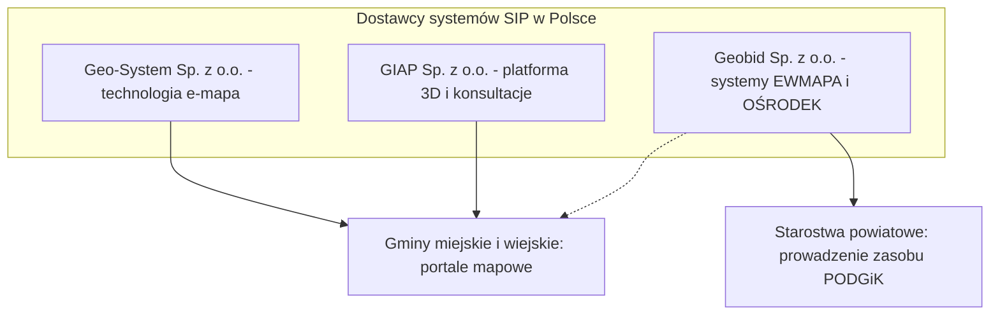

# Analiza rynku systemów informacji przestrzennej w Polsce

## 1. Struktura rynku systemów geodezyjnych i SIP

Rynek oprogramowania dla gmin i powiatów w Polsce obejmuje systemy informacji przestrzennej (SIP) oraz oprogramowanie do prowadzenia państwowego zasobu geodezyjnego i kartograficznego. Większość wdrożeń w jednostkach samorządowych realizowana jest przez wąską grupę wyspecjalizowanych podmiotów.

Identyfikacja ich rozwiązań technologicznych, formatów danych oraz modeli wdrożeniowych pozwala na ocenę warunków przetargowych i przygotowanie konkurencyjnych ofert.

---

## 2. Główni dostawcy systemów na rynku samorządowym

---

### 2.1. Geo-System Sp. z o.o. (system e-mapa)

Geo-System dostarcza przeglądarkowe portale mapowe dla gmin w domenie `*.e-mapa.net`, funkcjonujące w około 2000 jednostkach samorządowych.

#### Cechy technologiczne:
* **Model SaaS**: Portale działają w chmurze producenta, bez konieczności utrzymywania dedykowanych serwerów mapowych przez urząd.
* **Integracja z rejestrami**: Połączenie z Państwowym Rejestrem Granic (PRG), ewidencją gruntów i budynków (EGiB) oraz ortofotomapą GUGiK.
* **Funkcjonalności interfejsu**:
  * Płynne sterowanie przezroczystością warstw planistycznych w formacie GML (Akty Planowania Przestrzennego),
  * Prezentacja wskaźników zagospodarowania (powierzchnia biologicznie czynna, intensywność zabudowy),
  * Integracja z siatką adresową what3words,
  * Walidacja dokumentów planistycznych z Rejestrem Urbanistycznym.

#### Ograniczenia operacyjne:
* Ograniczone wsparcie dla zaawansowanych modeli trójwymiarowych (3D Mesh, Digital Twin).
* Zamknięta architektura chmurowa utrudniająca integrację z niestandardowymi bazami danych urzędu.

---

### 2.2. GIAP Sp. z o.o. (portale 3D i partycypacja)

Firma koncentruje się na systemach informacji przestrzennej ze szczególnym uwzględnieniem wizualizacji 3D oraz modułów konsultacji społecznych.

#### Cechy technologiczne:
* **Konsultacje społeczne**: Przestrzenne formularze ankietowe do opiniowania projektów Miejscowych Planów Zagospodarowania Przestrzennego (MPZP) oraz Planów Ogólnych.
* **Portale inwestycyjne**: Moduły analityczne 3D do weryfikacji chłonności terenu i ograniczeń wysokościowych zabudowy.
* **Wektoryzacja archiwalnych planów**: Doświadczenie w przetwarzaniu analogowych dokumentów planistycznych do formatów cyfrowych.

#### Ograniczenia operacyjne:
* Wyższe wymagania sprzętowe i koszty utrzymania środowisk trójwymiarowych w porównaniu ze standardowymi mapami 2D.
* Mniejsza integracja z bazami geodezyjnymi prowadzonymi w powiatach.

---

### 2.3. Geobid Sp. z o.o. (EWMAPA, OŚRODEK)

Oprogramowanie firmy Geobid jest powszechnie stosowane w Powiatowych Ośrodkach Dokumentacji Geodezyjnej i Kartograficznej (PODGiK) do prowadzenia mapy zasadniczej i ewidencji gruntów.

#### Cechy technologiczne:
* **EWMAPA**: Graficzny system do prowadzenia mapy numerycznej (bazy BDOT500, GESUT, EGiB).
* **OŚRODEK**: Baza opisowa do obsługi operatu geodezyjnego i kartograficznego.
* **Silnik bazodanowy**: Długoletnie oparcie architektury o relacyjną bazę danych Firebird.
* **Formaty wymiany**: Wykorzystanie plików o strukturze wsadowej (format `.str`), specyficznych dla programu EWMAPA.

#### Bariery przetargowe:
Z racji powszechności EWMAPY w powiatach, urzędy gmin w specyfikacjach przetargowych formułują wymóg:
> *Wykonawca przekaże zaktualizowaną bazę danych w formacie bezpośrednio importowalnym do programu EWMAPA (pliki .str) bez utraty powiązań i historii modyfikacji.*
Wymóg ten ogranicza konkurencję, faworyzując podmioty dysponujące licencjami jednego producenta kosztem wykonawców stosujących otwarte standardy OGC (GML v3.2.1).

---

## 3. Zestawienie rozwiązań

| Cecha | Geo-System (e-mapa) | GIAP Sp. z o.o. | Geobid (EWMAPA/OŚRODEK) | Standard otwarty |
| :--- | :--- | :--- | :--- | :--- |
| Model wdrożenia | SaaS (chmura) | Web / On-Premise / SaaS | Desktop (Windows) + Baza | Web (Docker / Cloud) |
| Formaty wymiany | GML, WMS, WFS | GML, GeoJSON, 3D Tiles | Zamknięte pliki .str, bazy Firebird | Otwarte standardy OGC (GML, GeoJSON) |
| Udział w gminach | Wysoki | Średni | Bardzo wysoki (pośrednio przez powiaty) | Zależny od polityki IT gminy |
| Moduły partycypacji | Podstawowe | Rozbudowane (ankiety 3D) | Brak | Moduły webowe dostosowane do potrzeb |
| Ryzyko uzależnienia | Średnie | Niskie | Wysokie | Brak (pełna interoperacyjność) |

---

## 4. Wykorzystanie danych rynkowych w bazie wektorowej

Baza systemu indeksuje:
1. Dokumentacje techniczne i specyfikacje formatów importu/eksportu konkurencji.
2. Zestawienia rozstrzygnięć przetargów z platformy e-Zamówienia (w tym uśrednione stawki za 1 ha prac geodezyjnych w danym województwie).
3. Orzeczenia KIO dotyczące kwestionowania wymogów formatu `.str` i braku neutralności technologicznej.
