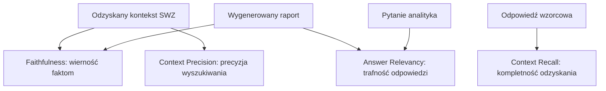

# Ewaluacja jakości odpowiedzi z użyciem RAGAS

## 1. Ograniczenia tradycyjnych metryk tekstowych

Tradycyjne metryki oceny tekstu (BLEU, ROUGE) bazują na zliczaniu wspólnych n-gramów. W analizie prawnej i zamówieniowej nie zdają one egzaminu, ponieważ zmiana pojedynczego słowa (np. dodanie partykuły "nie") odwraca sens prawny zdania, przy zachowaniu wysokiego współczynnika zbieżności n-gramów.

Ocena jakości generowanych raportów wymaga weryfikacji semantycznej opartej na podejściu modelowym (LLM-as-a-judge).

---

## 2. Metryki ewaluacyjne RAGAS

System integruje bibliotekę RAGAS (Retrieval Augmented Generation Assessment) do ciągłej weryfikacji generowanych treści:



### 2.1. Faithfulness (wierność faktom)
* **Definicja**: Stosunek liczby twierdzeń znajdujących bezpośrednie potwierdzenie w przekazanym kontekście SWZ do całkowitej liczby twierdzeń w wygenerowanym raporcie.
* **Formuła**:
  $$\text{Faithfulness} = \frac{|\text{Twierdzenia potwierdzone w kontekście}|}{|\text{Wszystkie twierdzenia w odpowiedzi}|}$$
* **Wymagany próg**: Wartość minimalna wynosi 0.95. Raporty niespełniające tego kryterium są blokowane przed prezentacją użytkownikowi.

### 2.2. Answer Relevancy (trafność odpowiedzi)
* **Definicja**: Ocena, czy raport odpowiada bezpośrednio na zadane pytanie analityczne, bez wprowadzania wątków pobocznych.
* **Metoda**: Model sędziowski generuje zapytania syntetyczne z wygenerowanej odpowiedzi i porównuje ich podobieństwo wektorowe z pytaniem użytkownika.

### 2.3. Context Precision (precyzja kontekstu)
* **Definicja**: Weryfikacja, czy najbardziej relewantne fragmenty dokumentacji znalazły się na pierwszych pozycjach listy przekazanej do modelu LLM.

### 2.4. Context Recall (kompletność kontekstu)
* **Definicja**: Stopień, w jakim odzyskany kontekst pokrywa wszystkie elementy zawarte w odpowiedzi wzorcowej przygotowanej przez eksperta.

---

## 3. Skrypt ewaluacyjny w Pythonie

```python
from datasets import Dataset
from ragas import evaluate
from ragas.metrics import answer_relevancy, context_precision, faithfulness


def run_ragas_evaluation(
    questions: list, answers: list, contexts: list, ground_truths: list
):
  data = {
      "question": questions,
      "answer": answers,
      "contexts": contexts,
      "ground_truth": ground_truths,
  }

  dataset = Dataset.from_dict(data)

  results = evaluate(
      dataset=dataset,
      metrics=[faithfulness, answer_relevancy, context_precision],
  )

  print(f"Faithfulness:      {results['faithfulness']:.4f}")
  print(f"Answer Relevancy:  {results['answer_relevancy']:.4f}")
  print(f"Context Precision: {results['context_precision']:.4f}")

  if results["faithfulness"] < 0.95:
    raise ValueError(
        f"Wskaźnik wierności faktom poniżej wymaganego progu 0.95:"
        f" {results['faithfulness']:.4f}"
    )

  return results
```
