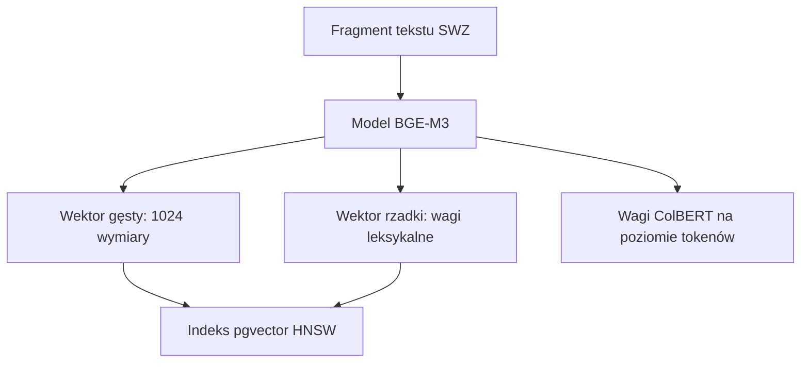

# Modele wektoryzacji i rerankingu

## 1. Model BAAI/BGE-M3

Model BAAI/BGE-M3 stanowi podstawę wektoryzacji w systemie. Jest to wielojęzyczny model obsługujący język polski, w tym specyficzną terminologię administracyjną i prawną.



### Parametry techniczne BGE-M3:
* **Wymiarowość wektora gęstego**: 1024 wartości zmiennoprzecinkowe,
* **Maksymalny kontekst wejściowy**: 8192 tokeny,
* **Tryby reprezentacji**: Generuje równolegle wektor gęsty oraz wektor rzadki (wagi słów kluczowych),
* **Tolerancja na błędy OCR**: Zachowuje zbliżone reprezentacje dla słów z uszkodzonymi znakami diakrytycznymi.

---

## 2. Model rerankingu: bge-reranker-v2-m3

Model bge-reranker-v2-m3 (Cross-Encoder) służy do ostatecznej oceny puli kandydatów wyselekcjonowanych w pierwszym etapie:
* **Architektura**: Pełna atencja krzyżowa (Cross-Attention) między zapytaniem a tekstem dokumentu.
* **Wejście**: Para `(zapytanie, fragment dokumentu)`.
* **Wyjście**: Wartość skalarna określająca stopień dopasowania.

---

## 3. Implementacja w Pythonie

```python
from typing import List, Tuple
from sentence_transformers import CrossEncoder, SentenceTransformer

embed_model = SentenceTransformer("BAAI/bge-m3", device="cpu")
reranker_model = CrossEncoder("BAAI/bge-reranker-v2-m3", device="cpu")


def generate_dense_embeddings(texts: List[str]) -> List[List[float]]:
  """Generuje znormalizowane wektory gęste 1024-wymiarowe."""
  embeddings = embed_model.encode(
      texts, normalize_embeddings=True, show_progress_bar=False
  )
  return embeddings.tolist()


def rerank_candidates(
    query: str, candidates: List[str], top_k: int = 5
) -> List[Tuple[str, float]]:
  """Wykonuje reranking wyselekcjonowanych kandydatów za pomocą Cross-Encodera."""
  pairs = [[query, text] for text in candidates]
  scores = reranker_model.predict(pairs)
  scored_results = sorted(zip(candidates, scores), key=lambda x: x[1], reverse=True)
  return scored_results[:top_k]


if __name__ == "__main__":
  query = "Czy wykonawca musi posiadać geodetę z uprawnieniami w zakresie 2?"
  candidates = [
      (
          "Kierownik zespołu musi posiadać uprawnienia zawodowe w dziedzinie"
          " geodezji i kartografii w zakresie 2."
      ),
      (
          "Wadium należy wpłacić na rachunek bankowy urzędu gminy do dnia 15"
          " maja 2026 r."
      ),
      (
          "Wykonawca wykaże, że dysponuje co najmniej dwoma specjalistami z"
          " uprawnieniami w zakresie 1."
      ),
  ]

  results = rerank_candidates(query, candidates, top_k=2)
  for text, score in results:
    print(f"[{score:.4f}] {text}")
```
